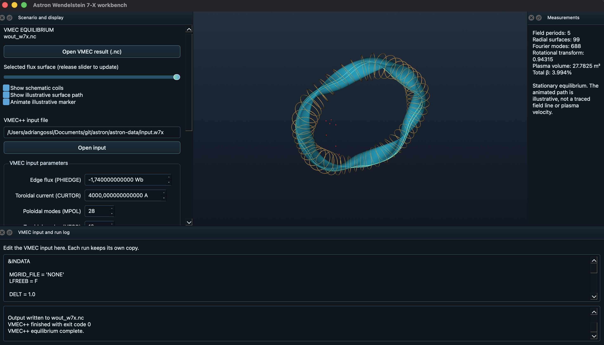

# Astron

Astron is a workbench for Wendelstein 7-X magnetic equilibria.

### UI
[](resources/pictures/ui.png)

## Build on Ubuntu 24.04 or WSL

Install dependencies:

```bash
sudo apt update
sudo apt install build-essential cmake ninja-build git pkg-config \
  qt6-base-dev libnetcdf-dev mesa-common-dev freeglut3-dev \
  libgl1-mesa-dev libx11-dev libxt-dev python3
```

Build and install VTK 9.5.2:

```bash
mkdir -p "$HOME/src" "$HOME/build" "$HOME/opt"
git clone --branch v9.5.2 --depth 1 --recursive \
  https://github.com/Kitware/VTK.git "$HOME/src/vtk"
cmake -S "$HOME/src/vtk" -B "$HOME/build/vtk-qt6" -G Ninja \
  -DCMAKE_BUILD_TYPE=Release \
  -DCMAKE_INSTALL_PREFIX="$HOME/opt/vtk-qt6" \
  -DVTK_QT_VERSION=6 \
  -DVTK_MODULE_ENABLE_VTK_GUISupportQt=YES \
  -DVTK_BUILD_TESTING=OFF \
  -DVTK_BUILD_EXAMPLES=OFF \
  -DVTK_ENABLE_WRAPPING=OFF
cmake --build "$HOME/build/vtk-qt6" --parallel 4
cmake --install "$HOME/build/vtk-qt6"
```

From the Astron checkout, configure and build:

```bash
cmake -S . -B build/debug -G Ninja \
  -DCMAKE_BUILD_TYPE=Debug \
  -DCMAKE_PREFIX_PATH="$HOME/opt/vtk-qt6" \
  -DCMAKE_EXPORT_COMPILE_COMMANDS=ON
cmake --build build/debug --parallel 4
./build/debug/astron
```

After a source change, `cmake --build build/debug --parallel 4` is enough.

If WSL uses slow software rendering, compare `glxinfo -B` with `GALLIUM_DRIVER=d3d12 glxinfo -B` after installing `mesa-utils`. When the D3D12 report shows hardware acceleration, launch with `GALLIUM_DRIVER=d3d12 ./build/debug/astron`. Do not set this on native Linux or macOS without checking the renderer.


## Get and use a W7-X equilibrium

Astron opens an existing VMEC `wout_*.nc` without VMEC++ installed. To generate one from the [VMEC++ W7-X example](https://github.com/proximafusion/vmecpp/blob/main/examples/data/input.w7x):

```bash
mkdir -p "$HOME/astron-data"
cd "$HOME/astron-data"
curl -L -o input.w7x \
  https://raw.githubusercontent.com/proximafusion/vmecpp/refs/heads/main/examples/data/input.w7x
uv tool install vmecpp
"$HOME/.local/bin/vmecpp" input.w7x
```

The resulting `wout_w7x.nc` is a calculated fixed-boundary equilibrium, not a recorded discharge. A full run can take several minutes. VMEC++ can also be installed using its [project instructions](https://github.com/proximafusion/vmecpp). On macOS, install a compatible solver separately.

In Astron, use **Open VMEC result (.nc)** to view a result. Use **Open input** to edit a VMEC input file. The controls expose existing `PHIEDGE`, `CURTOR`, `MPOL`, and `NTOR` assignments; apply control changes to the editor before running.

## Tests and code checks

```bash
cmake -S . -B build/debug -G Ninja \
  -DCMAKE_BUILD_TYPE=Debug \
  -DCMAKE_PREFIX_PATH="$HOME/opt/vtk-qt6" \
  -DCMAKE_EXPORT_COMPILE_COMMANDS=ON \
  -DASTRON_BUILD_TESTS=ON
cmake --build build/debug --parallel 4
ctest --test-dir build/debug --output-on-failure
```

For local style and static analysis on Ubuntu, install `clang-format-18` and `clang-tidy-18`, then run:

```bash
find src tests -type f \( -name '*.cpp' -o -name '*.h' \) -print0 | \
  xargs -0 clang-format-18 --dry-run --Werror
python3 tools/check_namespace_style.py
find src tests -type f -name '*.cpp' -print0 | \
  xargs -0 clang-tidy-18 -p build/debug -warnings-as-errors='*' --quiet
```
